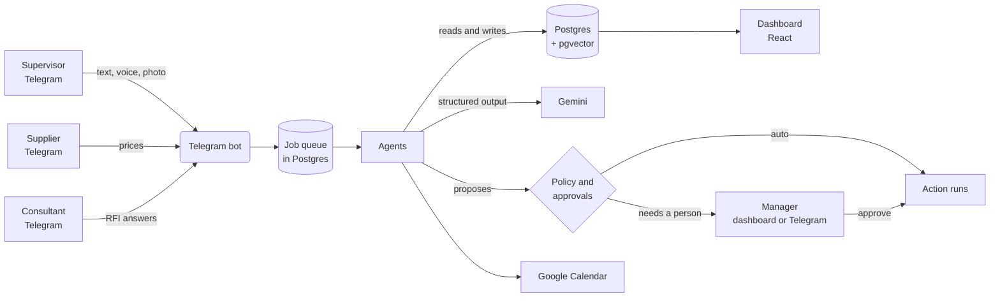

# SiteMate

**A project controls engineer for small and mid-sized building contractors in Ethiopia.**

Supervisors report from site on Telegram, in Amharic or English, by text, voice note or photo. SiteMate turns those reports into an up-to-date schedule, warns about delays before they hit the handover date, orders materials before they run out, keeps the claims file and payment claims in order, and asks a person before it does anything that matters.

**Live:** [sitemate-sigma.vercel.app](https://sitemate-sigma.vercel.app) &nbsp;·&nbsp; **Bot:** [@sitematedemo_bot](https://t.me/sitematedemo_bot) &nbsp;·&nbsp; **Demo login:** `pm@abay.demo` / `sitemate-demo`

> The live API runs on a free Render instance. If it has been idle, the first request takes about half a minute to wake it.

---

## Why

A large contractor has a planning engineer who updates the programme every week, chases the consultant for drawings and keeps the evidence for extension of time claims. A contractor running two or three G+4 buildings in Addis usually does not. The project manager keeps it in their head, in Excel and in WhatsApp, and the cost shows up later: cement runs out on a pour day, a delay is noticed after the notice period has passed, a claim is lost because nobody wrote down when the drawing arrived.

SiteMate does that job from the information the site already produces, the supervisor's end of day message.

## What it does

| | |
|---|---|
| **Daily site loop** | Every evening the bot asks each supervisor for the day's report. Text, voice notes and photos are read together, follow-up questions are asked when something important is missing, and the result is a structured daily log. |
| **Live schedule** | Progress from the log updates a critical path schedule. Each delay is measured against the handover date and priced with the contract's delay damages. Recovery options are costed and can be applied with one approval. |
| **Three-week look-ahead** | Every activity coming up is checked for what it is waiting on: earlier work, materials, weather, or an answer from the consultant. |
| **Materials and buying** | Usage is learned from the logs and matched with the work planned ahead to forecast run-out dates. When stock will not last the supplier's lead time, a purchase request is raised, suppliers are asked for prices on Telegram, quotes are compared and the order goes out once approved. Prices taken by phone can be entered by hand. |
| **Cost control** | Bill of quantities, labour from the worker counts, materials from deliveries. Earned value (SPI, CPI) and an S-curve, and an interim payment claim drafted from measured progress at month end. |
| **Requests for information** | When a supervisor reports work waiting on a drawing or a decision, an RFI is drafted against that activity. Once approved it goes to the consultant on Telegram and their reply is recorded as the answer. The activity shows as blocked until then. |
| **Claims file** | Delays caused by the client, the consultant or exceptional weather open an evidence file as they happen, with the effect on completion from time impact analysis and a drafted notice before the contract's notice period runs out. |
| **Project memory** | The contract and specification are indexed. Anyone can ask SiteMate a question and get an answer with the clause it came from, and reported work is checked against the specification. |
| **Calendar** | The look-ahead, order-by dates, notice deadlines and RFI due dates are kept on a shared Google Calendar. |

## Try it

1. Open the [live site](https://sitemate-sigma.vercel.app) and choose **Use the demo account**. The demo company has two buildings with seven weeks of history.
2. Or choose **Create an account**, then **Create the sample project**, to get your own copy to change.
3. To try the Telegram side, open **Team**, add yourself as a supervisor, choose **Link to Telegram** and send the code to [@sitematedemo_bot](https://t.me/sitematedemo_bot). Then send a report like the one below and refresh **Daily logs**, **Schedule** and **Materials** a minute later.

```
Today we had 12 masons, 6 steel fixers and 15 labourers. Floor one columns are
finished. Beam and slab formwork is about 30 percent. We used 40 bags of cement
and 20 m3 of sand was delivered. Rain stopped work for two hours. The slab
reinforcement cannot start, we are still waiting for the revised drawing.
```

## How it works



**Agents.** Each agent is a small module that reacts to an event or a timer and does one job.

| Agent | Triggered by | What it does |
|---|---|---|
| Site | Supervisor messages, evening check-in | Reads the report with Gemini, asks follow-ups, writes the daily log |
| Schedule | Every daily log | Applies progress, recalculates the critical path, records delays, prices recovery |
| Weather | 06:30 every morning | Checks the forecast against weather-sensitive work and proposes holds |
| Procurement | Daily logs, stock counts, a daily check | Forecasts run-out and raises purchase requests |
| Quotes | Supplier replies | Reads the price from the supplier's own words, compares quotes, proposes the order |
| Cost | Daily logs, month end | Books labour, keeps earned value, drafts payment claims |
| Planning | Saturdays | Commits next week's work and scores last week (percent plan complete) |
| Claims and RFIs | Delays, site issues, overdue answers | Keeps the evidence file, drafts notices and RFIs, sends RFIs to the consultant |
| Documents | Uploads, questions | Indexes the contract and specification, answers with the clause, checks work against the spec |
| Calendar | Every hour and after each log | Keeps the team calendar in step |

**Approvals.** The rules for what an agent may do alone are code, not prompt text, so a model output cannot talk its way past them. Recording, reminding and notifying run on their own. Anything that changes the plan, spends money or leaves the company waits for the right person: the project manager, or the owner for purchases above 200,000 birr. Approvals can be given on the dashboard or with a button on Telegram, and every decision is kept in the audit log.

**The AI is boxed in.** Every Gemini call asks for structured output against a schema and the answer is validated before it is used. If it does not match, the model gets one more try with the errors. The arithmetic (critical path, earned value, run-out dates, delay impact) is done by deterministic code in `packages/engine`, never by the model. When the main model is overloaded, a lighter backup model takes over.

**Background work runs on Postgres.** Jobs are rows claimed with `FOR UPDATE SKIP LOCKED`, retried with backoff, protected against duplicates with idempotency keys and given a time limit. There is no Redis or other queue to run.

## How well it reads

The reading is measured, not assumed. `apps/api/evals` holds 30 site reports and 12 supplier replies written the way they actually arrive: plain English, phone shorthand with typos, Amharic, Amharic mixed with English, and cases that trip people up (a supervisor correcting themselves, the same workers counted twice, work that is not in the schedule, a safety near miss). Each has the answer a careful project engineer would take from it. The runner sends them through the same prompt, schema and checks as production and scores the result.

| | Cases | Fully correct |
|---|---:|---:|
| English | 8 | 8 |
| English, informal | 6 | 6 |
| Amharic | 8 | 8 |
| Amharic and English mixed | 3 | 3 |
| Hard cases | 5 | 5 |
| Supplier prices | 12 | 12 |

Fully correct means the worker count, the activities, percent complete (within 10 points), materials used and received, and every problem that should be flagged all match. The first run found two real mistakes: an activity mentioned as "not started yet" was recorded as worked on, and a supplier who replied with just a price ("1150") was not understood. Both were fixed in code and the prompt, and the set now passes in full. It is a small set, so read this as "these cases pass", not "it is never wrong". Full results are in [`apps/api/evals/RESULTS.md`](apps/api/evals/RESULTS.md); run them with `pnpm --filter @sitemate/api eval`.

## Tech stack

| Area | Choice |
|---|---|
| Language | TypeScript throughout, pnpm workspace |
| Scheduling engine | Own code, no dependencies: CPM with FS, SS, FF and SF links, lags and constraints, working calendars with Ethiopian holidays, delay analysis, earned value |
| API | Node.js 24, Fastify 5, Zod |
| Database | PostgreSQL with pgvector, Drizzle ORM and migrations. Neon in production, embedded PGlite for local development and tests |
| AI | Google Gemini for text, Amharic voice, photos and quotes; `gemini-embedding-001` for document search |
| Messaging | Telegram Bot API, called directly. Long polling locally, webhook in production |
| Integrations | Google Calendar through a service account, Open-Meteo weather, open exchange rates |
| Auth | Own implementation: scrypt password hashes, hashed session tokens, roles, rate limiting |
| Dashboard | React 19, Vite 7, Tailwind CSS 4, React Router 7, TanStack Query 5. Gantt chart and S-curve drawn in SVG |
| Quality | Vitest (208 tests), GitHub Actions for CI |
| Hosting | Vercel (dashboard), Render (API and bot), Neon (database) |

## Repository layout

```
apps/
  api/        Fastify API, agents, Telegram bot, job queue, migrations, seed data
  web/        React dashboard
packages/
  engine/     Scheduling, delay analysis, forecasting and earned value. Pure functions.
scripts/
  verify.sh   Builds the engine, typechecks and runs every test
.github/
  workflows/  CI, and a 15 minute scheduler ping for the hosted API
```

## Running it locally

You need Node.js 20 or newer and pnpm (`corepack enable` gives you the right version).

```bash
git clone https://github.com/Yeabsirashimelis/sitemate.git
cd sitemate
pnpm install

# API settings. Everything is optional for a first look.
cp .env.example apps/api/.env

# Load the demo company into a local database
pnpm --filter @sitemate/api seed

# In two terminals
pnpm --filter @sitemate/api dev     # API on http://localhost:3000
pnpm --filter @sitemate/web dev     # dashboard on http://localhost:5173
```

Without `DATABASE_URL` the API keeps its data in an embedded Postgres under `apps/api/.data`. Only one process can open that folder at a time, so stop the API before running the seed again (`pnpm --filter @sitemate/api seed --reset`).

Without a Gemini key the dashboard and the schedule work, but reading reports, quotes and documents is switched off. Without a Telegram token the bot is off.

### Configuration

The API reads its settings from the environment or from `apps/api/.env`.

| Variable | Needed for | Notes |
|---|---|---|
| `GEMINI_API_KEY` | Reading reports, quotes, documents | From [Google AI Studio](https://aistudio.google.com/apikey) |
| `TELEGRAM_BOT_TOKEN`, `TELEGRAM_BOT_USERNAME` | The bot | From @BotFather |
| `DATABASE_URL` | Production | Any Postgres with pgvector. Leave empty locally to use the embedded one |
| `WEB_ORIGIN` | Production | Dashboard address allowed to call the API |
| `PUBLIC_URL`, `TELEGRAM_WEBHOOK_SECRET` | Production | The API registers its own Telegram webhook on start |
| `JOBS_SECRET` | Production | Protects `POST /jobs/tick`, which the scheduler workflow calls |
| `GOOGLE_CALENDAR_ID`, `GOOGLE_SERVICE_ACCOUNT_FILE` | Calendar sync | Share the calendar with the service account, "Make changes and see all event details" |
| `GEMINI_MODEL`, `GEMINI_FALLBACK_MODEL` | Optional | Main and backup model |
| `SITE_TIME_ZONE`, `CLAIM_NOTICE_DAYS`, `PAYMENT_DUE_DAYS` | Optional | Default to Addis Ababa, 28 and 30 days |

The dashboard needs one setting, `VITE_API_URL`, which defaults to `http://localhost:3000`.

### Importing a schedule

Projects take their programme as CSV, which Excel, MS Project and Primavera can all export. One row per activity:

```csv
code,name,duration,predecessors,kind,zone,progress_unit,planned_quantity
A100,Site clearing and setting out,3,,general,Site,,
A110,Excavation for footings,5,A100,excavation,Foundation,m3,140
A210,First floor beam and slab formwork,6,A200SS+2,general,First floor,m2,160
```

Durations are in workdays. Predecessors are separated by `;` and may carry a link type and lag, as in `A200SS+2`. The logic is checked before anything is saved and the calculated dates become the baseline. A sample file can be downloaded from the **New project** form.

## Tests

```bash
bash scripts/verify.sh
```

This builds the engine, typechecks all three packages and runs the tests: 28 for the engine, 172 for the API and 8 for the dashboard. API tests run against a fresh in-memory Postgres with fake Gemini, Telegram, weather and calendar clients, so they need no keys and no network. CI runs the same script on every push.

## Deployment

| Part | Service | Setup |
|---|---|---|
| Dashboard | Vercel | Root `apps/web`, settings in `apps/web/vercel.json`, deploys on every push to `main` |
| API and bot | Render web service | Build `corepack enable && pnpm install --frozen-lockfile && pnpm --filter @sitemate/api build`, start `node apps/api/dist/server.js`, health check `/health`. The Google key is a Render secret file |
| Database | Neon | Migrations run when the API starts |
| Timers | GitHub Actions | `scheduler.yml` calls `/jobs/tick` every 15 minutes, which also keeps the free instance awake |

## Decisions worth explaining

- **Telegram, not an app.** Supervisors already use Telegram all day, and it handles voice and photos on cheap phones with poor connections. Nothing to install or learn.
- **The engine is plain code.** Schedules, money and contract deadlines have to be right every time and explainable. The model reads messy human input; it never does the sums.
- **Postgres for everything.** Data, job queue, audit log and document vectors live in one database, so a job and the data it changes are always consistent and there is one less service to run and pay for.
- **People approve, agents propose.** For a small contractor a wrong order or a letter sent to the consultant by mistake is expensive. Every outward or costly action waits for one tap from the right person.
- **CSV for schedules.** Every planning tool in use can export it, and it keeps the import honest and testable.

## Known limits

- The free Render instance sleeps after 15 minutes without traffic. The scheduler ping keeps it mostly awake; a paid instance removes the wait.
- The consultant and suppliers receive messages on Telegram. Email delivery is not built yet; the dashboard gives the RFI as a letter to copy or open in an email client instead.
- One Telegram account is one SiteMate user. Someone who is both a supervisor and a supplier needs two accounts.
- Exchange rates and weather come from free public services without an uptime guarantee. Both fail safe: a missing forecast skips the weather check rather than guessing.

---

Built by [Yeabsira Shimelis](https://github.com/Yeabsirashimelis) as a take-home project for Brain3.
